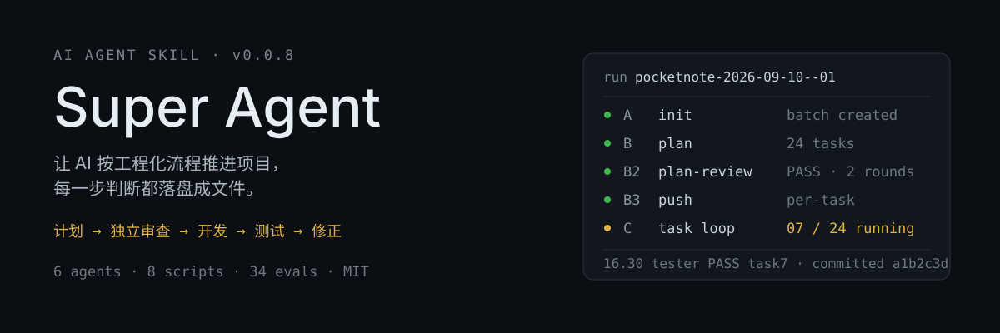
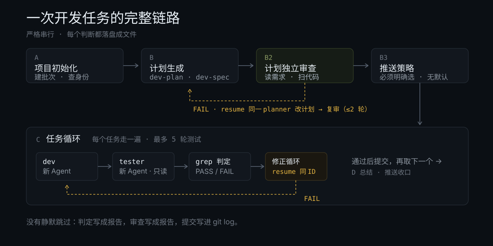
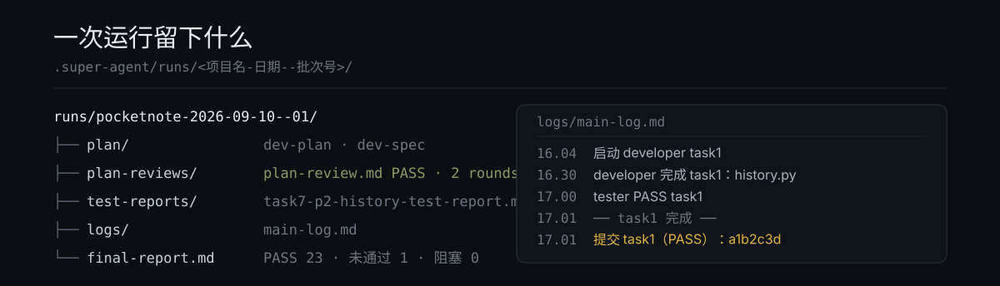

<p align="center">
  
</p>

<p align="center">
  <a href="LICENSE"></a>
  
  
</p>

**Super Agent** 是一个 AI Agent Skill。加载它之后，AI 不再一口气把代码写完就交差，而是按「**计划 → 独立审查 → 开发 → 测试 → 修正**」推进，每一步都留下文件证据。

它解决的不是"AI 不会写代码"，而是**写完之后你不敢信**：为什么这么写、测过什么、改坏了没有。

---

## 为什么不是"一个 agent 从头做到尾"

单个 agent 独立跑完整套任务，会撞上四个瓶颈：

| 瓶颈 | 具体表现 |
|---|---|
| **上下文窗口爆炸** | 长对话让注意力分散，模型记不住自己之前为什么这么写 |
| **修 bug 失忆** | 修一个问题时，已经忘了当初的实现意图和测试报告里的缺陷 |
| **自己测自己** | 写代码的 agent 自测，缺少独立审查视角 |
| **计划错了全盘返工** | 计划作者自己检查计划，容易漏需求、把下游排在依赖它之前；跑到第 10 个任务才发现顺序倒置 |

Super Agent 的解法是**角色分离 + 计划独立审查 + 修正循环**，并把每一次判断写成文件。

---

## 工作流



| 阶段 | 做什么 | 产出 |
|---|---|---|
| **A** 项目初始化 | 建批次目录、检查提交身份是否被 IDE 覆盖 | `.super-agent/runs/<批次>/`、`run.json` |
| **B** 计划生成 | 读需求文档，拆任务、定编码规范 | `plan/dev-plan.md`、`dev-spec.md`、`requirements.md` |
| **B2** 计划独立审查 | 新 agent 读需求全文 + 扫真实代码，核需求覆盖与任务顺序 | `plan-reviews/plan-review.md` |
| **B3** 推送策略 | 你选逐任务推送还是批次末推送（**没有默认值**） | `run.json.push_policy` |
| **C** 任务循环 | dev → tester → 判定 → 修正，每任务最多 5 轮测试 | 代码、`test-reports/`、git 提交 |
| **D** 收尾 | 汇总每轮结果与风险 | `final-report.md` |

> 主智能体工作阶段（A/B/C/D）≠ 项目开发阶段（`dev-plan` 里的 P0/P1/P2）。P 阶段由 planner 一次性写完整，主智能体只读它找任务，不重新规划。

---

## 它留下什么



所有产出落在**目标项目**的 `.super-agent/` 下，不依赖对话上下文，也不会进你的 git 历史（提交范围只包含业务代码）。

---

## 角色分工

| 角色 | 剧本文件 | 职责 |
|---|---|---|
| **主智能体**（编排者） | `agents/orchestrator.md` | 拆任务、调度子智能体、写日志、判 PASS/FAIL。**永不修改业务代码** |
| **计划智能体** | `agents/planner.md` | 生成项目骨架、`dev-plan.md`、`dev-spec.md`；审查 FAIL 时被 resume 修计划 |
| **计划审查智能体** | `agents/plan-reviewer.md` | 开工前独立审查计划：读需求文档全文 + 扫真实代码结构。**只写审查报告，不改计划** |
| **开发智能体** | `agents/developer.md` | 按单个任务写代码、记录变更、修正 bug |
| **测试智能体** | `agents/tester.md` | 只读审查、写测试报告。**永不修改业务代码** |
| **评估智能体**（可选） | `agents/grader.md` | 回归评估，输出 `benchmark.json` |

角色剧本可以按项目替换，但**不得改变**主智能体的串行调度、同 ID resume 和上下文隔离规则。

---

## 计划独立审查

planner 是计划作者，作者不给自己判卷。任何一行代码开工之前，必须由一个**全新的** plan-reviewer 过一遍：

```
planner 出计划
     ↓
plan-reviewer（新 Agent）── 读需求文档全文 + 扫目录 / 依赖 / 入口 / 表定义
     ↓
  判定 FAIL ─► resume 同一 planner 改计划 ─► resume 同一 plan-reviewer 复审（最多 2 轮）
     ↓ PASS
进任务循环
```

它盯七件事：**需求覆盖、顺序与依赖、代码现状契合、粒度与可验证性、编号与阶段、风险与外部依赖、测试可行性**。

只有**阻塞项**才判 FAIL（会导致返工的那些），「建议项」照记但不拦路。2 轮仍 FAIL 时必须停下来问你：手工调整 / 接受风险开工 / 停止批次 —— 主智能体不得自行放行。

---

## 修正循环

测试不通过时，不是重新开一个 agent，而是 **resume 同一个 agent**：

```
开发 Agent（新 ID）──► 测试 Agent（新 ID）
      ▲                       │
      │                     FAIL
      │                       ▼
      └── resume 同一 dev ◄───┘
                （修完）
                  ↓
         resume 同一 tester（重测）
```

保留上下文的 resume 机制，是"修 bug 不失忆"的关键。同一任务最多测试 **5 轮**，第 5 轮仍 FAIL 则标记 ⚠️ 为「未通过（已放行）」，不阻塞后续任务。

---

## 提交与推送

提交和推送是**两件事**：

- **提交**：每个任务判定完成后立即提交（本地存档点），✅ / ⚠️ / ❌ 三态都提交。
- **推送**：时机由你在循环开始前选一次。

| 你选的 | 行为 |
|---|---|
| **A. 逐任务推送** | 每个任务提交后立刻推送，问题能及时暴露；被拒就停手报告，绝不 `--force` |
| **B. 批次末统一推送** | 每个任务只提交，全部跑完后列出待推清单，**你点头才推** |

两种**没有默认值**：必须明确选 A 或 B 才会开工。没回答、回答含糊、或让 AI "看着办"时，它不会自行挑一个，而是重新问；仍不明确就停下等你。

策略在**计划审查通过后、第一个任务开始前**问一次，写进 `run.json.push_policy`，续跑同一批次不会重复问。**项目不是 git 仓库、或者没有配置远端时，整套 git 动作直接跳过** —— 连本地提交都不做，只在日志和报告里标一句"未启用提交"。

推送统一走 `scripts/push_task.py`：先用 `ls-remote` 判断远端有没有这个分支，再用 `merge-base` 判断远端是否领先本地，最后才 `git push -u origin {branch}`。所以既不会因为"本地没有 upstream"卡住，也不会盲推一个注定被拒的 push。

**提交序号即任务号**：planner 的 P0 前置工作固定编号 `task0`，不进 dev/test 循环、也不提交；开发任务从 `task1` 起连续编号。git log 的第一条永远是 `task1`，`taskN` 就是第 N 条提交。

提交消息只有一行标题：

| 判定 | 提交消息 |
|---|---|
| ✅ 通过 | `task7: 历史记录封面持久化` |
| ⚠️ 用尽 5 轮 | `task7 [未通过]: 历史记录封面持久化` |
| ❌ 未能判定 | `task7 [未能判定]: 历史记录封面持久化` |

### 提交身份

Trae 这类 IDE 会在进程里注入 `GIT_COMMITTER_NAME=trae-solo-agent`，让提交署名成工具名，而 `.gitconfig` 看起来完全正常。技能在**加载时**就会比对配置身份与实际身份，不一致就问你一次：

| 你的选择 | 记录位置 | 下次 |
|---|---|---|
| A 用 IDE 默认，本项目不再提示 | 项目 `.super-agent/preferences.json` | 跳过询问，署名 IDE |
| B 本轮用我自己的 | 本批次 `run.json` | 新批次会再问 |
| C 本项目以后都用我的 | 项目 `.super-agent/preferences.json` | 跳过询问，署名你 |

记录按项目存放，A 项目选了 IDE、B 项目仍可以选你自己。想改主意：`python scripts/git_identity.py --repo <项目> --clear`。

---

## 硬约束：所有智能体调用必须严格串行

> **本 skill 的多智能体协同流程中，所有智能体调用必须严格串行执行，包括测试子代理之间。**

这不是性能取舍，而是保护 resume 机制与上下文隔离的设计前提，与"主智能体不能直接修改业务代码"**同等地位**。违反任意一条，都视为破坏本 skill：

| # | 行为 | 规则 |
|---|---|---|
| 1 | 主智能体修改业务代码 | 严格禁止 |
| 2 | 一个任务对应一个 dev Agent | 禁止复用同 ID dev 处理多个任务 |
| 3 | 下一个任务的启动时机 | 必须等当前任务完全完成（含修正循环） |
| 4 | 测试子代理之间 | 必须串行，不能多个 tester 同时跑 |
| 5 | tester FAIL → 修 bug | resume 同一 dev Agent，不开新 dev |
| 6 | dev 修完 → 重测 | resume 同一 tester Agent，不开新 tester |
| 7 | 跨 role 并行（如前后端同时跑） | 不允许 |
| 8 | 更新 `dev-plan.md` | 只能用 Edit 单行替换，禁止 Write 覆盖整个文件 |
| 9 | 任务判定完成 | 必须立即提交（三态都提交），未提交不得取下一个任务 |
| 10 | 计划审查 | planner 完成后必须启动**全新**的 plan-reviewer；判定 PASS（或你明确接受风险）才能启动第一个 dev |
| 11 | 审查 FAIL | resume 同一 planner 改计划 + resume 同一 plan-reviewer 复审；最多 2 轮，仍 FAIL 必须问你 |
| 12 | 推送到远端 | 循环开始前问一次策略（无默认）；批次末策略必须你确认；永不 `--force` |

### 五条不可破坏的原则

| 原则 | 含义 |
|---|---|
| **文件即记忆** | 所有产出（计划、代码、报告、经验）必须落盘到当前批次目录，不依赖对话上下文 |
| **隔离即常态** | 每个子智能体只看到主智能体传过去的内容，假设它不知道任何业务背景 |
| **记录即保险** | 所有时间由 `scripts/now.py` 获取，禁止推算 |
| **路径即接口** | 主智能体只拿文件路径、不读内容；子智能体收到路径后自己读 |
| **resume 同 ID** | 修 bug resume 同开发 Agent，重测 resume 同测试 Agent，修计划 resume 同 planner，新任务开新 Agent |

---

## 安装

```bash
# 方式一：用 skills-manager（推荐）
skills-manager-cli.exe skills install https://github.com/super-mortal/super-agent
skills-manager-cli.exe skills deploy super-agent --agent codex
```

```bash
# 方式二：手动放到工具的 skills 目录
git clone git@github.com:super-mortal/super-agent.git
#   ~/.codex/skills/super-agent
#   ~/.claude/skills/super-agent
#   ~/.workbuddy/skills/super-agent
```

依赖 **Python >= 3.10**，脚本仅用标准库，无第三方依赖。

---

## 第一次运行

加载 skill 后，向 AI 提供 **项目根目录** 和 **需求文档路径**：

```
加载 super-agent skill，帮我开发 my-project 项目，需求文档在 /path/to/requirements.md
```

接下来它会自己走完 A → D。你只会在三个地方被问到：

1. 提交身份有冲突时（一次，可选记忆）
2. 计划审查不通过时（最多 2 轮后）
3. 选推送策略时（一次，没有默认值）

`taskN` 与 `git log` 第 N 条提交一一对应，所以进度可以直接从提交历史读：

```bash
git log --oneline        # task1 … task7，做到哪一目了然
```

---

## 目录结构

```
super-agent/
├── SKILL.md                        主入口（完整规范）
├── agents/                         角色剧本
│   ├── orchestrator.md             主智能体（编排者）
│   ├── planner.md                  计划智能体
│   ├── plan-reviewer.md            计划审查智能体（需求覆盖 + 顺序审查）
│   ├── developer.md                开发智能体
│   ├── tester.md                   测试智能体（只读审查）
│   └── grader.md                   评估智能体（可选）
├── references/                     参考规范
│   ├── workflow-diagram.md         完整流程图（泳道图）
│   ├── message-protocol.md         主 ↔ 子智能体消息协议
│   ├── task-decomposition.md       任务划分策略（粒度 / 顺序 / 依赖）
│   ├── logging-format.md           日志格式规范
│   ├── error-codes.md              错误码命名规范模板
│   └── directory-structure.md      项目内 .super-agent/ 目录约定
├── scripts/                        工具脚本
│   ├── init_workspace.py           创建新的批次目录
│   ├── now.py                      输出统一北京时间
│   ├── grep_judgement.py           从测试 / 审查报告提取 PASS/FAIL
│   ├── register_error_code.py      分配并登记新错误码
│   ├── commit_task.py              按统一格式提交单个任务的改动
│   ├── push_task.py                推送前探活并推送
│   ├── git_identity.py             检查并记录提交身份
│   └── estimate_context.py         估算 prompt 的 token 数
├── assets/                         模板文件（init 时复制到项目）
│   ├── plan-template.md            dev-plan.md 模板
│   ├── spec-template.md            dev-spec.md 模板
│   ├── log-template.md             main-log.md 模板
│   ├── lessons-template.md         lessons-learned.md 模板
│   ├── context7-record-template.md context7-record.md 模板
│   ├── requirements-template.md    需求文档模板
│   ├── final-report-template.md    final-report.md 模板
│   └── readme/                     README 视觉资产（hero / workflow / ledger）
└── evals/
    └── evals.json                  评测用例
```

项目内产出：

```
<你的项目>/.super-agent/runs/<项目名-日期--批次号>/
├── run.json                批次元信息与状态
├── plan/                   dev-plan / dev-spec / requirements / 经验库
├── plan-reviews/           计划独立审查报告（首审 + 复审追加段）
├── test-reports/           每个任务固定一个测试报告
├── logs/main-log.md        主智能体日志
└── final-report.md         批次最终汇报
```

### 工具脚本

```bash
# 创建新批次（同一天已有批次时自动递增批次号；编号只按日期计数，跨前缀连续）
python {skill_root}/scripts/init_workspace.py {project_root} \
  --project-name {project_name} --error-prefix {error_prefix}

# 获取当前北京时间（写日志前必须重新运行，禁止推算）
python {skill_root}/scripts/now.py

# 严格提取判定（测试报告与审查报告同一协议）
python {skill_root}/scripts/grep_judgement.py {run_root}/test-reports/{report}.md --strict
python {skill_root}/scripts/grep_judgement.py {run_root}/plan-reviews/plan-review.md --strict

# 登记新错误码（自动分配编号并检查重复）
python {skill_root}/scripts/register_error_code.py {run_root}/plan/dev-spec.md \
  --prefix {error_prefix} --module AUTH --http 401 \
  --meaning "用户未登录或登录已过期" --location "middleware/auth.py:42"

# 推送预览与推送（--confirm 必须由用户明确选择后才加）
python {skill_root}/scripts/push_task.py --repo {project_root}
python {skill_root}/scripts/push_task.py --repo {project_root} --confirm
```

---

## 适用 / 不适用

**✅ 适用**

- 长期、可追溯、需要独立审查的开发任务
- 有明确需求文档、任务可被拆解和独立验证的项目
- 希望保留「为什么这么写」决策链路的场景
- 修 bug 时需要复用原 Agent 上下文的任务

**❌ 不适用**

- 一次性小修改（agent 直接改就行，上这套流程是杀鸡用牛刀）
- 强耦合、无法独立验证的任务（拆了反而更难）
- 只要写代码片段、不需要多智能体协作
- 只是回答问题或解释概念

评测用例见 `evals/evals.json`（34 条），覆盖初始化、计划审查、修正循环、提交推送、身份确认与越权防护。

---

## License

[MIT](LICENSE) © 2026 super-mortal
